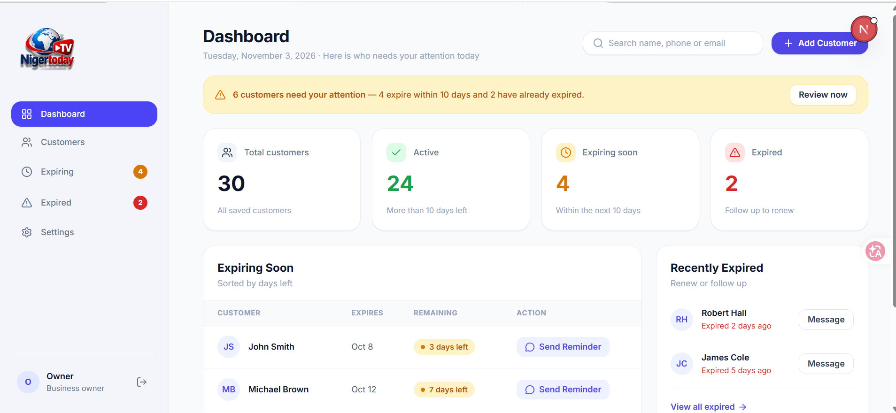
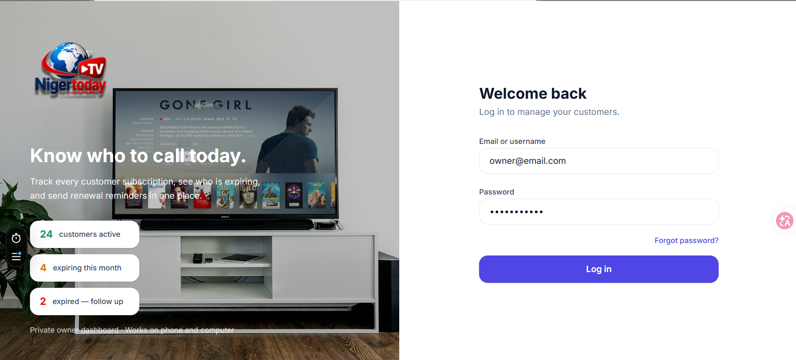
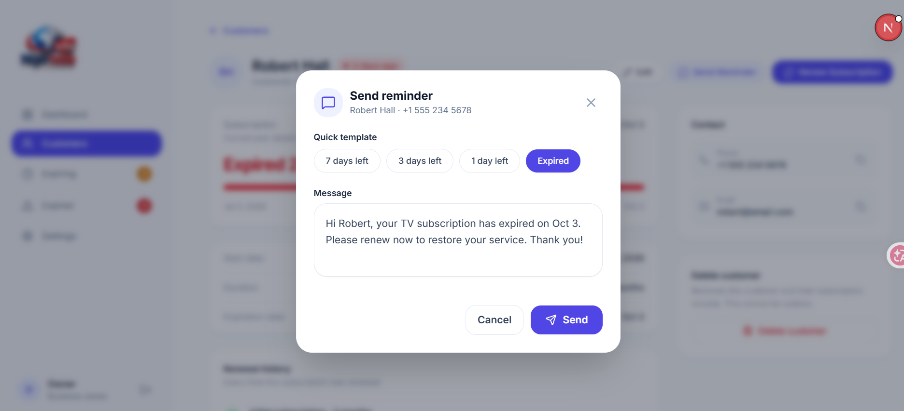

# GTV NigerToday — Customer & Subscription Management Dashboard

A modern, high-performance, and pixel-perfect SaaS frontend built with **Next.js (App Router)**, **React 19**, **TypeScript**, and **Tailwind CSS**.

---

## 🎨 Figma Design Origin

This entire frontend application was meticulously crafted **pixel-for-pixel** directly from the official Figma design:

👉 **[View Figma Design (NigerToday Custom Dashboard)](https://www.figma.com/design/2WVTIbLqugYP13WSiyNfVZ/nigertodaynew-%7C%7C-Custom-Dashboard-%7C%7C--380-USD--Copy-?node-id=5-2&p=f&t=DP6tAnxbgbqHLuji-0)**

* **100% Pixel-Perfect:** Exact colors, typography, borders, card geometries, icon alignments, and interactive hover/active states.
* **Fully Responsive:** Seamlessly adapted from ultra-narrow mobile viewports (280px–360px) all the way up to ultra-wide desktop monitors.
* **Plug-and-Play Backend Architecture:** Designed with clean decoupled service layers. The frontend is 100% complete and production-ready — simply hook up your backend API endpoints and it runs instantly.

---

## 📸 Screenshots & UI Previews

### 1. Dashboard Overview


### 2. Authentication & Login


### 3. Send Reminder & Popups


---

## 🚀 Key Features

* **Real-Time Subscription Analytics:**
  * Total Customers, Active Customers, Expiring Soon, and Expired metrics.
  * Attention Warning Banners for urgent renewals.
* **Customer Management (Full CRUD):**
  * Instant search by customer name, phone number, or email.
  * Filter tabs: `All`, `Active`, `Expiring`, and `Expired`.
  * Comprehensive Customer Profile View with subscription timeline and progress bars.
  * Add Customer & Edit Customer workflows with live auto-calculated expiry dates.
* **Automated Expiry & Reminder System:**
  * Quick message templates: `7 days left`, `3 days left`, `1 day left`, and `Expired`.
  * Direct SMS / Notification trigger + one-click **WhatsApp** dispatch (`wa.me` integration).
* **Robust Authentication & Security:**
  * Server-side Next.js Middleware (`middleware.ts`) guarding all dashboard routes.
  * Unauthenticated users are strictly redirected to `/login`.
  * Active session persistence via secure cookies and local storage.
  * Settings & Password change modals with real-time feedback.
* **Mobile-First & Ultra-Responsive:**
  * Adaptive Bottom Navigation on mobile with slide-over drawer sidebar.
  * Zero horizontal scrollbars (`overflow-x: hidden`).
  * Custom touch targets and optimized padding for mobile users.

---

## 🔌 Backend Integration Guide (Plug & Play)

The frontend data layer is entirely decoupled into two clean service files. To connect your real backend, you **only** need to replace the mock functions in these two files with your `fetch()` or `axios` API calls:

### 1. Customer & Subscription Service (`src/services/customerService.ts`)
| Function | HTTP Method | Endpoint | Description |
| :--- | :--- | :--- | :--- |
| `getCustomers()` | `GET` | `/api/customers` | Fetch all customers |
| `getCustomerById(id)` | `GET` | `/api/customers/:id` | Fetch single customer details |
| `createCustomer(data)` | `POST` | `/api/customers` | Add a new customer |
| `updateCustomer(id, data)` | `PUT` | `/api/customers/:id` | Edit customer information |
| `deleteCustomer(id)` | `DELETE` | `/api/customers/:id` | Remove customer record |
| `renewCustomer(id, months)` | `POST` | `/api/customers/:id/renew` | Extend customer subscription |
| `getDashboardStats()` | `GET` | `/api/stats` | Fetch aggregated dashboard counts |

### 2. Authentication Service (`src/services/authService.ts`)
| Function | HTTP Method | Endpoint | Description |
| :--- | :--- | :--- | :--- |
| `login({ email, password })` | `POST` | `/api/auth/login` | Authenticate user & return token |
| `logout()` | `POST` | `/api/auth/logout` | Terminate session & clear tokens |
| `getCurrentUser()` | `GET` | `/api/auth/me` | Fetch currently authenticated user |
| `updateProfile(data)` | `PUT` | `/api/auth/profile` | Update account name & email |
| `changePassword(data)` | `PUT` | `/api/auth/change-password` | Update account password |

> **Note:** All UI components, hooks (`useCustomers`, `useCustomer`, `useAuth`), and Context providers (`CustomerContext`, `AuthContext`) are already fully wired. No frontend components need to be modified when connecting the backend!

---

## 🛠️ Tech Stack

* **Framework:** [Next.js](https://nextjs.org/) (App Router, Server & Client Components)
* **Language:** [TypeScript](https://www.typescriptlang.org/) (Strict Type Safety)
* **Styling:** [Tailwind CSS v4](https://tailwindcss.com/)
* **Icons:** [Lucide React](https://lucide.dev/)
* **Typography:** Inter (via `next/font`)
* **Linting & Quality:** ESLint (`next/core-web-vitals`), Prettier-ready

---

## 💻 Getting Started

### 1. Prerequisites
Ensure you have **Node.js 18+** installed on your system.

### 2. Installation
Clone the repository and install dependencies:
```bash
git clone https://github.com/zahirraihan26/NigerToday.git
cd NigerToday
npm install
```

### 3. Run Development Server
```bash
npm run dev
```
Open [http://localhost:3000](http://localhost:3000) with your browser.

### 4. Build for Production
```bash
npm run build
npm run start
```

### 5. Code Quality Check
```bash
npx tsc --noEmit    # TypeScript type check (0 errors)
npm run lint         # ESLint verification (0 errors, 0 warnings)
```

---

## 📄 License
Private & Proprietary — NigerToday TV Subscription Management System.

